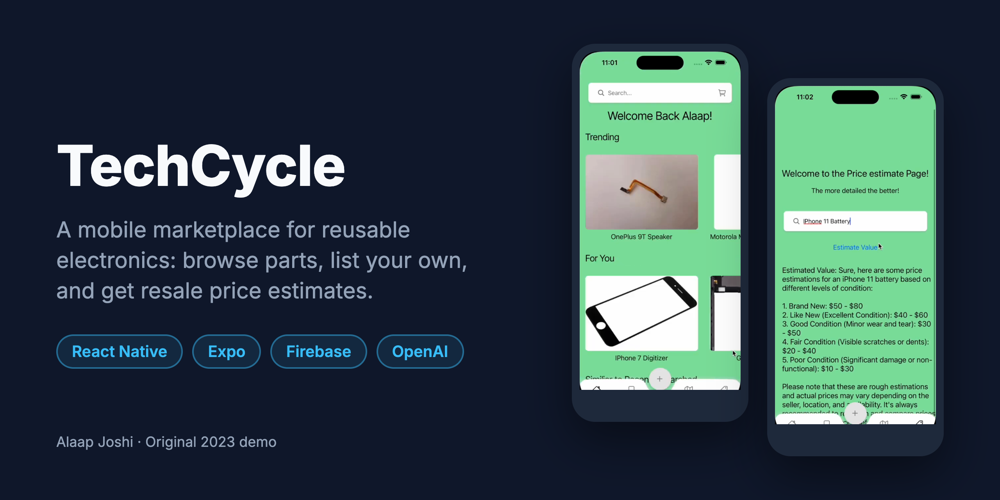
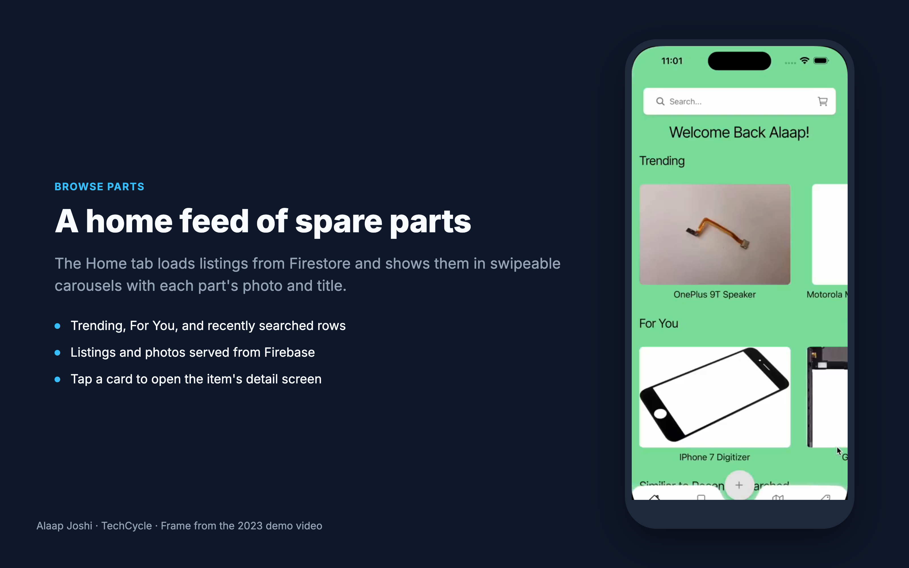
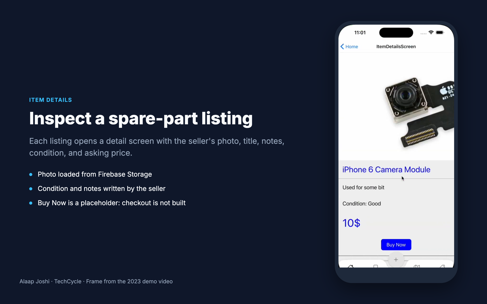
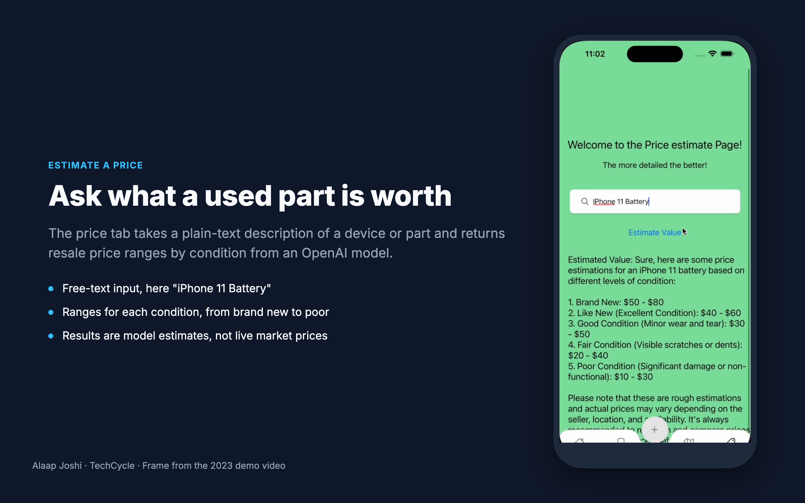
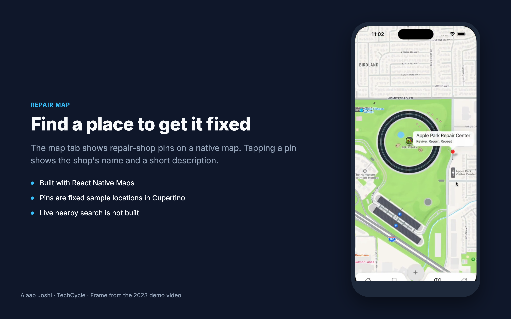
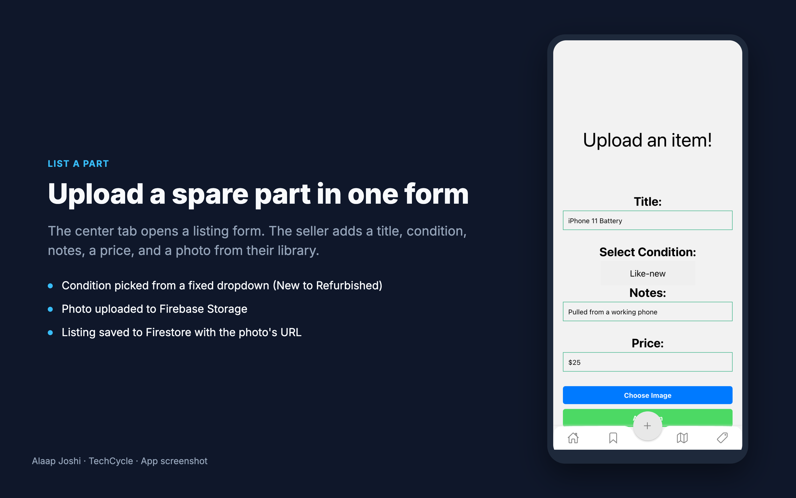
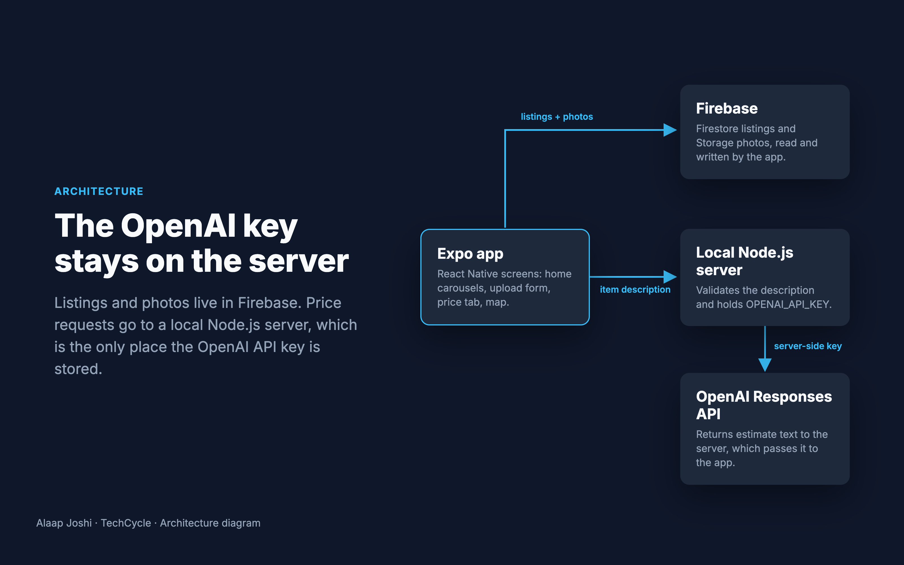

# TechCycle

> A mobile marketplace for finding reusable electronics, listing spare parts, and estimating their resale value.

   

## About

Built solo at **PeddieHacks 2023**, with a project update dated **August 19, 2023**. TechCycle helps people reuse electronics by browsing spare parts, creating listings, and requesting resale price estimates. React Native provides the mobile interface, Firebase stores listings and photos, and a local Node.js service handles price requests. It won **Solo Prize (USA Address only)**; [Devpost](https://devpost.com/software/techcycle) lists Alaap Joshi as its sole creator. TODO(Alaap): confirm the hackathon date range.

## Features

- Shows Firestore listings in Trending, For You, and related-item carousels, with item detail screens.
- Creates listings with a photo, title, notes, condition, and price, saving the photo URL after upload.
- Estimates approximate device or part prices through a local OpenAI proxy, with loading and error feedback.
- Displays a map with fixed repair-shop markers in the Cupertino area.

## Gallery

<table>
  <tr>
    <td width="50%"> Browse spare parts in the original demo</td>
    <td width="50%"> Inspect a listing; checkout is a placeholder</td>
  </tr>
  <tr>
    <td width="50%"> Request resale price estimates</td>
    <td width="50%"> Explore fixed sample repair locations</td>
  </tr>
  <tr>
    <td width="50%"> Create a spare-part listing</td>
    <td width="50%"> Current architecture: credentials stay on the server</td>
  </tr>
</table>

The first four images are frames from the [original Devpost demo](https://www.youtube.com/watch?v=VKVpra67uo4), recorded in 2023; the current interface and price service differ. The upload image is an existing local capture. TODO(Alaap): confirm its capture environment and date. Sources and regeneration instructions are in [the image notes](docs/images/README.md).

## Tech Stack

| Layer | Technology |
|---|---|
| Mobile | JavaScript, React 18, React Native 0.72, Expo SDK 49 |
| Navigation and UI | React Navigation, React Native Reanimated, React Native Maps |
| Listings and photos | Firebase Firestore and Storage |
| Price service | Node.js built-in HTTP server, OpenAI Responses API |
| Tools | Expo CLI, Node.js test runner |

## Getting Started

### Prerequisites

- Node.js 20.12 or newer (the `server` script uses `--env-file`). The app targets Expo SDK 49, so use an iOS Simulator or Android setup that supports SDK 49 development builds. TODO(Alaap): confirm the simulator/Expo Go version you run it with.
- Xcode and an iOS Simulator on macOS, or a compatible Android development environment.
- A Firebase project with Firestore and Storage enabled and rules suitable for your own development data.
- Optional: an OpenAI API key with billing and access to the configured model, for price estimates.

### Installation

~~~bash
git clone https://github.com/alaapjoshi/TechCycle.git
cd TechCycle
npm ci
npm run setup
~~~

The setup wizard asks for the private OpenAI key without displaying it, then asks for Firebase's web app configuration. Find the Firebase fields in your project's web app settings. It writes ignored `.env` and `server/.env` files; leave fields blank to configure later. The app opens without Firebase configured and explains what is missing.

Firebase's `EXPO_PUBLIC_FIREBASE_*` settings identify the client project and are bundled into the app. Protect your data with Firebase rules. **Never put a private OpenAI key in an `EXPO_PUBLIC_*` variable.** It belongs only in `server/.env` as `OPENAI_API_KEY`. The default `OPENAI_MODEL` is `gpt-4.1-mini` and can be changed in that server file.

For manual setup instead:

~~~bash
cp .env.example .env
cp server/.env.example server/.env
~~~

Fill in the copied files locally. Restart Expo after changing client environment settings.

### Usage

Start the local price service in one terminal:

~~~bash
npm run server
~~~

Start the mobile app in another terminal, from the same project directory:

~~~bash
npm run ios
~~~

The Home tab displays configured Firestore collections: `trending`, `foryou`, and `store`. Existing listing documents use `title`, `desc`, `price`, `imageURL`, and `condition`; the carousel supplies the document ID for its list key. Use the center upload button to select a photo and add a listing to `foryou`. Each listing is saved with its uploaded photo, title, description, price, and condition.

On the price tab, enter a device or part description such as `iPhone 11 replacement battery` and tap **Estimate Value**. Estimates depend on the model and are not live marketplace quotes. Without server credentials, the app shows a setup message. The local service listens only at `http://127.0.0.1:3012`; this works from the iOS Simulator on the same Mac. A physical phone cannot reach that loopback service. Remote hosting, authentication, and physical-device AI access are future deployment work.

Run the automated checks without an API key or Firebase account:

~~~bash
npm test
~~~

Tests cover price-service requests and the image-upload/listing-save sequence without contacting external services.

## Project Structure

~~~text
TechCycle/
  App.jsx                    # entry point
  Navigate.jsx               # bottom navigation
  firebase.js                # shared Firebase initialization and public configuration
  pages/Home/                # listing carousels and item details
  pages/upload/              # image selection and sequenced listing creation
  pages/price/               # local-server price-estimate client
  pages/map/                 # fixed repair-shop markers
  server/                    # private-key local AI proxy and tests
  scripts/setup.mjs          # interactive local configuration
  docs/images/               # cover, gallery, and their HTML sources (src/)
~~~

## How It Works

~~~mermaid
flowchart LR
  App[Expo app] -->|read listings| Firestore[(Firestore)]
  App -->|upload selected image| Storage[(Firebase Storage)]
  Storage -->|download URL| App
  App -->|save listing with its URL| Firestore
  App -->|device description| Proxy[Local Node server]
  Proxy -->|private server credential| OpenAI[OpenAI Responses API]
  OpenAI -->|estimate text| Proxy
  Proxy --> App
~~~

Image selection stays local until submission. The submit flow awaits one Storage upload and the resulting download URL before writing the listing document; an upload failure prevents the write. Price requests send only the item description to the local service, which validates the request and calls OpenAI using its server-side credential. The proxy limits request size, restricts browser origins to localhost, and returns errors without provider credentials.

## Known Limitations

- The app uses Expo SDK 49 and needs a compatible development client.
- Purchasing, messaging, cart actions, and search filtering are unfinished.
- Repair-shop markers are fixed locations in Cupertino, not live nearby results.
- Price estimates are model-generated ranges, not live marketplace quotes.
- Authentication and production hosting are not included. The local AI service runs on the same Mac as the iOS Simulator.

## Future Improvements

- Add authenticated listing ownership and rules before sharing a hosted marketplace.
- Implement search filtering and refresh listings after an upload.
- Add deliberate cleanup for uploaded photos whose listing write fails.
- Replace fixed repair markers with a maintained location source and deploy an authenticated price service.

## Author

**Alaap Joshi** - Computer Science + Cognitive Science, Rutgers University-New Brunswick
[GitHub](https://github.com/alaapjoshi) | [LinkedIn](https://linkedin.com/in/alaapjoshi)

## License

MIT. See [LICENSE](LICENSE).
